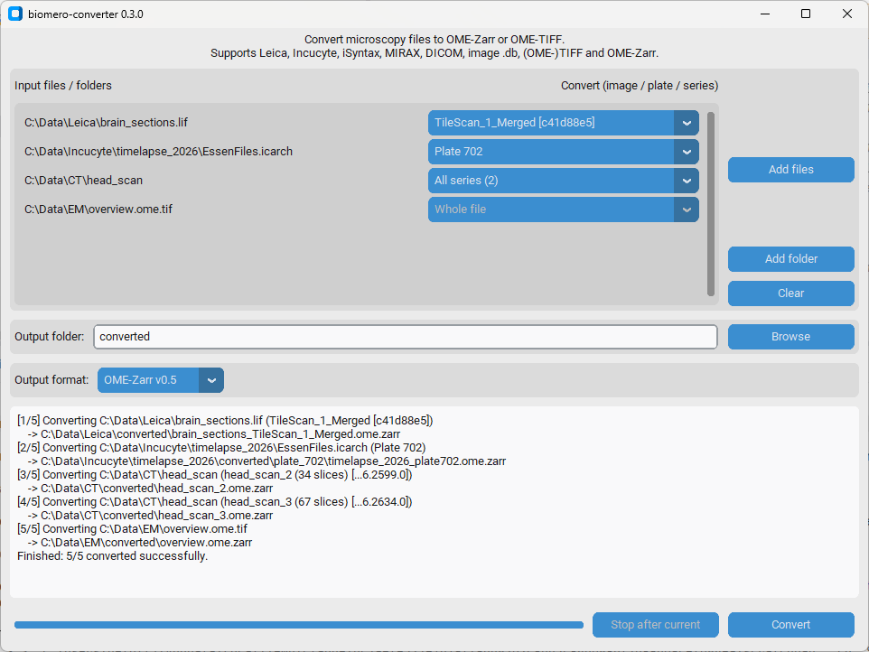

# Desktop GUI

biomero-converter includes an optional desktop application for converting files without the command line.
It runs on Windows, macOS and Linux.



## Install and start

```sh
pip install "biomero-converter[gui]"
biomero-converter-gui
```

The `[gui]` extra installs [customtkinter](https://github.com/TomSchimansky/CustomTkinter). The command line,
Docker image and Python API do not need it.

Tk must be available in the Python installation:

- Windows: included with the python.org and conda installers.
- macOS: use Python from python.org or conda (Tk 8.6).
- Linux: install your distribution's Tk package, e.g. `sudo apt install python3-tk`, or use conda.

## Use

1. **Add files** or **Add folder** (folder inputs such as OME-Zarr or DICOM folders); several inputs can be queued.
2. Next to each input, choose **what to convert**. When an input is added, its contents are read and listed:
    - Leica files: their images, by name (with the start of the image UUID, or `#index` for older files);
    - Incucyte archives: their plates (`Plate <id>`);
    - DICOM files and folders: their series, by the name the converted series gets, with the number of slices.

    The default **All ...** converts every image, plate or series separately. Other inputs (e.g. TIFF, OME-Zarr,
    image `.db`) are converted as a whole.
3. Choose the **output folder**: **Browse** to a folder, or type a **relative path** (e.g. `converted`, or `.`) to
   write each input's output next to it: `C:\Data\Leica\a.lif` with `converted` is written to
   `C:\Data\Leica\converted`. For folder inputs (DICOM, OME-Zarr) the relative path starts from the folder that
   contains them, so output is never written inside them.
4. Choose the **output format** (default: OME-Zarr 0.5, see `DEFAULT_OUTPUT_FORMAT` in [Convert](convert.md)).
5. **Convert.** Everything is converted one after the other; the log shows each output path. If a conversion fails,
   the error is logged and the next one continues. **Stop after current** stops after the conversion in progress.

Closing the window during a conversion stops after the current conversion and then closes.

The lists come from `biomero_converter.helper.get_selections()`, which other tools can also use.

## Use in another application

The interface is also available as widgets, so other customtkinter/tkinter applications can host it:

```python
from biomero_converter.gui import ConverterFrame, ConverterWindow

ConverterWindow(master)             # the interface in its own child window
frame = ConverterFrame(parent)      # or as a widget inside an existing window
frame.add_inputs(['path/to/file.lif'])
frame.set_output_folder('path/to/output')
```

For applications frozen with PyInstaller, biomero-converter provides a PyInstaller hook (registered automatically)
that bundles the data files and libraries it needs at runtime.

## Acknowledgements

The desktop GUI started as the biomero-converter module of the
[UMIC Toolkit](https://github.com/BHPD/UMIC_Toolkit) by Peter Duinkerken, a GUI toolkit for UMIC microscopy
workflows, and was moved into biomero-converter so it can be used on its own. The UMIC Toolkit opens this GUI
as one of its modules.
